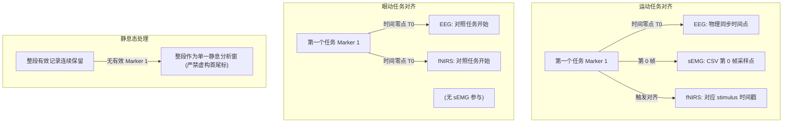

# 事件标记与多模态时间对齐规范

本规范规定多模态脑机与运动功能评估系统（EEF_analyze）中事件标记（Event Marker）的定义、跨模态时间对齐逻辑、各任务类型的标记解析策略以及丢失标记的边界推断算法。

---

## 1. 核心定义与基本原则

### 1.1 Marker 1 的本质属性
- **时间同步与任务边界，非任务类型编码**：
  数据中记录的任务触发标记绝大多数数值为 `1`。数值 `1` **绝不编码**具体任务名称（即 `1` 不代表“摸头”，也不代表“摸膝”或“握拳”）。
- **任务类型的判定依据**：
  严禁根据“标记值为 1”直接推断动作。任务类型判定必须综合以下要素：
  1. 标记出现的先后时间序列；
  2. 相邻标记之间的时间间隔（如运动 Block 约 24 秒，大任务转换约 45 秒）；
  3. 临床预设实验方案的固定动作执行顺序；
  4. 跨设备硬件时钟对齐结果。
- **自动打标与时间可信度**：
  当前运动任务中的 marker 由设备硬件或触发控制软件自动发送，其物理时间戳视为**精准可信**（`observed`）；任务名称则是根据已确认的固定实验方案协议赋予的协议标签（`protocol_labeled`）。

---

## 2. 跨模态时间零点与对齐规则

不同实验任务涉及的硬件组合不同，时间零点的定义必须严格区分：

### 2.1 运动任务（三模态同步）
- 运动任务同时采集 EEG、sEMG 和 fNIRS。
- sEMG 启动正式记录时，同步向 EEG 和 fNIRS 发送外部硬件触发脉冲。
- **时间对齐公式**：
  $$\text{运动任务第一个标} = \text{三模态正式同步采集起点} = \text{sEMG 第 0 帧 / 首个采样点}$$
  $$\text{sEMG 相对时间} = \text{EEG / fNIRS 标记时间} - \text{运动任务首标时间}$$

### 2.2 眼动任务（双模态同步）
- 眼动任务仅采集 EEG 与 fNIRS，**无 sEMG 设备**。
- 眼动首标仅用于 EEG 与 fNIRS 的时间基准对齐，同时标志任务 A 的第一阶段开始；**严禁**将眼动标记映射到任何 EMG 帧。

### 2.3 静息态（连续无标）
- 当前静息态导出文件中通常无可用任务标记。
- **处理红线**：静息态应将整段有效数据视为一个完整的静息任务区间；**严禁**因缺少标记判为无效，亦**严禁**在记录内部伪造或虚构标记。

### 2.4 非任务事件的识别与剔除
- **EEG 阻抗事件**：`evt.bdf` 中常伴随出现 `Start Impedance` 与 `Stop Impedance`。这些属于硬件阻抗巡检事件，必须彻底排除，不得参与任务分段。
- **fNIRS 触发去重**：NirSmart 导出的 `.nirs` 中，偶发同一物理触发在多个相邻 stimulus 通道重复记录的情况。应在约 **1.0 秒合并窗口**内执行去重，防止误判为多次打标。

---

## 3. 各任务类型的标记结构与序列规范

### 3.1 运动任务标记结构
既定实验动作执行顺序为：
1. **手掌上举摸头**（5 个 Block）；
2. **手触摸对侧膝部**（5 个 Block）；
3. **手背触摸同侧后腰部**（5 个 Block）。

每个 Block 动作约持续 5 秒，随后休息约 15 秒（总周期约 20--24 秒）；动作大项转换之间有较长的间歇（约 45 秒）。

- **标准 20 标结构**：
  - 首标为同步与起点；
  - 随后的 19 个标共同划定三个动作的 15 个 Block 边界与转换间隔；
  - 按照既定协议顺序，前 5 个 Block 赋予“摸头”，中间 5 个 Block 赋予“摸膝”，后 5 个 Block 赋予“摸腰”。
- **新增握拳动作（`2026081401` 与 `2026081403`）**：
  - `2026081401`：存在第 21--25 个标，属于新增的握拳动作 Block；
  - `2026081403`：存在第 21--24 个标，属于部分完成的握拳动作；
  - **处理规范**：第 21 个标及之后的内容**严禁**并入前三个标准动作中，仅作为探索性握拳或审计记录保留。

---

### 3.2 眼动任务结构与标准六标序列

眼动实验包含两大任务：
- **任务 A**（4 个小任务，按顺序执行）：1. 对照 $\to$ 2. 追随 $\to$ 3. 正向眼跳 $\to$ 4. 反向眼跳。
- **任务 B**（图像搜索）：包含 16 个图像识别试次，总持续时长约 80 秒。

#### 标准六标序列定义表

| 标记序号 | 物理意义与业务角色 | 区间划分与对应任务 |
| :---: | :--- | :--- |
| **标 1** | EEG 与 fNIRS 同步起点，任务 A “对照”开始 | 标 1 $\to$ 标 2：**对照任务** |
| **标 2** | 任务 A “追随”开始 | 标 2 $\to$ 标 3：**追随任务** |
| **标 3** | 任务 A “正向眼跳”开始 | 标 3 $\to$ 标 4：**正向眼跳** |
| **标 4** | 任务 A “反向眼跳”开始 | 标 4 $\to$ 标 5：**反向眼跳** |
| **标 5** | 任务 B “图像搜索”开始 | 标 5 $\to$ 标 6：**图像搜索 (任务 B)** |
| **标 6** | 任务 B “图像搜索”结束，整个眼动实验结束 | 实验完成退出 |

---

## 4. 异常与缺失标记的推断与标注要求

### 4.1 五标眼动记录反推算法
在部分记录中，眼动任务仅记录到 5 个标。若粗暴将第 5 标视作任务 B 开始，会导致图像搜索时长丢失。系统采用如下经过实证验证的反推规则：

1. **前四标保真**：前 4 个标依然忠实映射为任务 A 的四个小任务开始（对照、追随、正向眼跳、反向眼跳）。
2. **末标末尾距离检验**：
   - 计算第 5 个标距 EEG/fNIRS 文件结束时间的时间差 $\Delta T_{\text{end}} = T_{\text{file\_end}} - T_{\text{marker\_5}}$。
   - 若 $\Delta T_{\text{end}} < 15\ \text{s}$（例如实测为 4 秒或 10 秒），则判定第 5 标为**任务 B 结束标**，而非开始标。
3. **开始边界反推计算**：
   $$T_{\text{inferred\_task\_B\_start}} = T_{\text{marker\_5}} - \Delta T_{\text{typical\_task\_B\_duration}}\quad (\approx T_{\text{marker\_5}} - 80\ \text{s})$$
4. **置信度与证据标记**：
   - 反推的开始时间必须满足 $T_{\text{marker\_4}} < T_{\text{inferred\_task\_B\_start}} < T_{\text{marker\_5}}$。
   - 该时间戳必须显式标注 `inference_status = "inferred"`，**严禁伪装为原始硬件标记**。
   - 若末标距离记录结束较远，则放弃自动推断，标注为 `NEEDS_MANUAL_REVIEW`。

---

## 5. 推荐的数据标记审计字段标准

在所有下游提取（如 `expanded_subtask_features.csv` 或契约账本）中，建议采用统一的事件字段集合：

| 字段名 | 类型 | 说明与典型取值 |
| :--- | :--- | :--- |
| `subject` | str | 外部统一受试者编号（如 `2026081401`） |
| `recording_path` | str | 原始数据相对路径 |
| `modality` | str | `EEG`, `EMG`, `FNIRS` |
| `raw_marker_value` | int | 原始硬件标记值（通常为 `1`） |
| `marker_index` | int | 记录内部按时间升序的标记索引（1-based） |
| `timestamp_seconds`| float | 距本文件起始采样的物理秒数 |
| `event_role` | str | `SYNC_START`, `SUBTASK_START`, `TASK_START`, `TASK_END`, `BLOCK_BOUNDARY` |
| `task_name` | str | `摸头`, `摸膝`, `摸腰`, `握拳`, `对照`, `追随`, `正向眼跳`, `反向眼跳`, `图像搜索`, `静息` |
| `inference_status` | str | `observed`（自动记录硬件标） `protocol_labeled`（按协议顺序赋予） `inferred`（算法反推边界） `missing`（明确丢失） |
| `evidence` | str | 推断证据（如 `fixed_duration_80s_backward`, `first_movement_sync`） |
| `confidence` | str | `HIGH`, `MEDIUM`, `LOW` |
