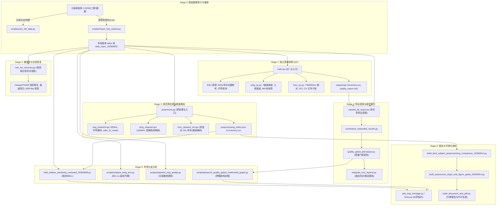

# 多模态信号分析与质控系统文档中心

欢迎查阅 **EEG / sEMG / fNIRS 多模态脑机与运动功能评估系统**（EEF_analyze）文档中心。本项目面向中医药现代化及康复功能评估场景，构建了覆盖数据摄取、跨模态时间对齐、离线质量评估（QC）、规范化预处理、低信噪比恢复、表型特征提取与跨模态图探索的全流程管线。

---

## 1. 快速导航索引

本文档体系采用分层模块化设计，覆盖项目生命周期的各个核心领域：

| 序号 | 专题文档 | 主要内容与定位 | 核心涉及模块 / 入口 |
| :--- | :--- | :--- | :--- |
| **01** | [全流程与各阶段入口清单及执行手册](file:///d:/Python_File/EEF_analyze/docs/01_ENTRYPOINTS.md) | Stage 0 至 Stage 6 的 6 大业务执行入口、命令范例、参数释义、输入输出及避坑指南 | `main.py`, `preprocess.py`, `low_snr_recovery.py`, `expand_all_cases.py` 等 |
| **02** | [多模态信号处理与质量门控规范](file:///d:/Python_File/EEF_analyze/docs/02_MULTIMODAL_PIPELINE.md) | EEG（64/32导帽、中位数重参考）、sEMG（7通道逻辑映射、IMU代理）、fNIRS（双波长OD、红外已知干扰）处理标准 | `emg_qc.py`, `fnirs_qc.py`, `preprocess.py`, `mbll_relative_sensitivity_reviewed_20260908.py` |
| **03** | [项目目录与数据产物资产全景](file:///d:/Python_File/EEF_analyze/docs/03_DIRECTORY_LAYOUT.md) | 根目录结构、`scripts/` 工具库分类、`tests/` 自动化测试集、`outputs/` 分层规范及阶段归档说明 | 目录全貌、阶段性产物版本对照、临时文件流向 |
| **04** | [事件标记与多模态时间对齐规范](file:///d:/Python_File/EEF_analyze/docs/04_EVENT_MARKERS.md) | Marker 1 定义、运动/眼动/静息任务时间同步逻辑、五标眼动记录反推算法及推荐数据字段 | `事件标记使用说明.md`, `explore_202608_cases.py`, `scripts/build_marker_alignment_audit.py` |
| **05** | [安全红线与数据治理规范](file:///d:/Python_File/EEF_analyze/docs/05_SAFETY_AND_GOVERNANCE.md) | J:\ 只读铁律、当前工作目录（cwd）与相对路径陷阱、`--overwrite` 递归安全、幂等性与可复现性机制 | 项目数据与运行安全规范 |

---

## 2. 多模态系统整体架构

系统从原始硬件记录输入，历经 6 个核心阶段，最终形成高质量研究报告与分析图谱：

---

## 3. 文档更新规范与维护责任

为保障文档与代码实现长期高度一致，所有维护者与智能体均须遵循以下准则：

1. **真实性第一**：所有文档记载的参数、默认值、路径与状态统计，必须基于代码实际读取与测试，严禁主观编造或过度推断。
2. **状态口径明确**：区分“复核态（Review）”与“优化态（Optimized）”，例如 2026-09-14 预处理的 107 条记录在两版本中的微调（v5 vs v6），必须如实记录。
3. **安全红线同步**：任何文档中涉及路径操作、命令执行的部分，均必须明确标注当前工作目录（cwd）与只读红线（`J:\2026二康` 严禁写操作）。
4. **超链接规范**：所有文档内部引用和代码文件链接均采用带有绝对路径的 GitHub Markdown 格式（如 `[main.py](file:///d:/Python_File/EEF_analyze/main.py)`）。
5. **版本留痕**：新增分析阶段或脚本时，应同步更新 [01_ENTRYPOINTS.md](file:///d:/Python_File/EEF_analyze/docs/01_ENTRYPOINTS.md) 与 [03_DIRECTORY_LAYOUT.md](file:///d:/Python_File/EEF_analyze/docs/03_DIRECTORY_LAYOUT.md)。
